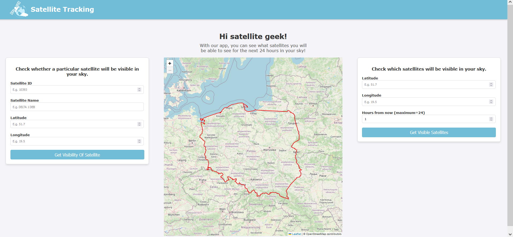
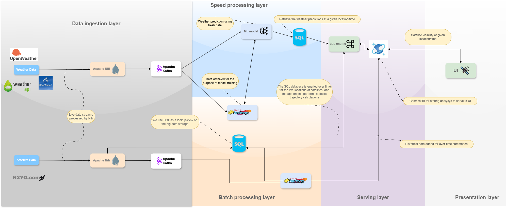
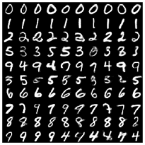
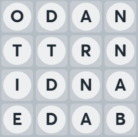
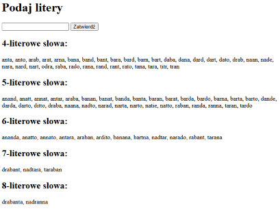
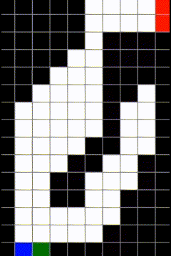
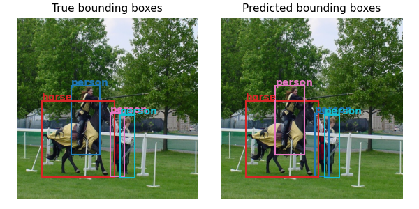

# Aspring Data Scientist

#### Technical Skills: Python, SQL, R, C/C++

## Education					       		
- M.S., Data Science | Warsaw University of Technology (_Sep. 2023 - Present_)		        		
- B.S., Mathematics and Data Analysis | Warsaw University of Technology (_Sep. 2019 - Oct. 2022_)

## Projects
### Satellite Tracking
In a group of four students, we developed a website that tells you which satellites are visible in the sky at a chosen location. It also provides a cloud cover forecast, which is updated every 15 minutes using our own machine learning models.

The goal of this project was to learn about Big Data solutions. We used technologies such as **Apache NiFi**, **Apache Kafka**, and a **Python** library called **River** for online machine learning. For data storage, we used **Azure Data Lake Storage**, **Cosmos DB**, and **MySQL**. Everything was set up in the **Azure Cloud**.

My main job was to develop a machine learning model for cloud cover forecasting that would be constantly updated with new weather data. I used the SNARIMAX model for time series forecasting. But besides that, I worked on setting up the cloud and databases, helped with the backend of the website and was kind of a project manager in our team. 

Unfortunately, the website is no longer available because we didn't want to pay for the cloud. You can find more details in [this report](). But I warn you that it was written to meet specific course requirements, so it may be a bit long and somewhat dry.

### Variational Deep Embedding (VaDE)
VaDE is a fascinating unsupervised model for clustering and data generation, proposed by [Jiang et al. 2016](https://arxiv.org/abs/1611.05148). I have implemented it using **TensorFlow** and trained it on the MNIST dataset (images of handwritten digits). Below are some examples of digits generated by my model.

During this project I've learned a lot about building custom models and training loops in **TensorFlow**. But my key takeaway is that even though the paper may initially seem complex and highly theoretical, breaking it down and implementing it step by step makes it much more approachable and helps in developing a deeper understanding of its concepts and practical applications.
You can see the code, brief report and presentation on [my github repository](https://github.com/adamczerw/ImplementingPapers/tree/main/VaDE).

### Boggle Solver
Boggle is a simple game where you find as many words as possible on a 4×4 letter grid. I've played it with my family for the past 15 years, so I can safely call it our tradition. That’s why I decided to create a **C++** program that finds all possible words on the board. To make it accessible for my parents, I built a website (**Python**+**Flask**) where they can use it.

  

You can find the C++ code [here](https://github.com/adamczerw/BoggleSolver).

### Self-driving car
While self studying reinforcement learning I implemented in **Python** one of the algorithms called Off-policy Monte Carlo control. To visualise its capabilities I created a simple desktop app where you can build your own track and make a "car" learn how to navigate it. The source code is in [my github repo](https://github.com/adamczerw/DrivingCarRL/tree/master).

### 500 features classification task
During an Advanced Machine Learning course, we were given a unique dataset consisting of 5000 clients in both the training and test sets, each described by 500 features. Our goal was to predict 1000 clients most likely to accept a specific offer, earning 10 virtual euros per successful sale. However, the challenge was that each feature used incurred a cost of 100 euros. By combining an extensive feature selection process with an ensemble of well-tuned models, we achieved a top-5 result in the class and earned the highest grade. You can read more [here](https://github.com/adam-narozniak/2024L-DSAdvancedML/blob/main/projects/project2/group3/Narozniak_Czerwonski_Rucinski/AML%20Project%202%20Report.pdf). Data Science libraries used: **XGBoost**, **LightGBM**, **Scikit-learn**, **Hyperopt**, **Pandas**, **NumPy**, **Matplotlib**.

### Implementing YOLO
In [Redmon et al. 2015] authors introduced a novel model for object detection called YOLO. It is still used till this day, although in different and improved forms. To get in depth understandment of it works I decided to code it from the scratch. You can find my Python notebook where I share my code and walk you through the implementation in **PyTorch** on [Kaggle](https://www.kaggle.com/code/jomenik/yolov1-pytorch-implementation/notebook) or on [Github](https://github.com/adamczerw/ImplementingPapers/tree/main/YOLO).

### Audio and Image Recognition
For the Image Recognition project, we built an image classification model to identify 10 different classes from the CINIC-10 dataset. We experimented with two CNN-based models—ResNet and VGG—combining them with various augmentations and transfer learning.

For the Audio Recognition project, we had to develop classification models for the [TensorFlow Speech Recognition Challenge](https://www.kaggle.com/competitions/tensorflow-speech-recognition-challenge) on Kaggle, but without using CNN architectures, which dominated the top-scoring solutions. I learned a lot about working with audio, especially the surprising insight that transforming it into a spectrogram allows it to be treated like an image. Initially, we trained an RNN model, but in the end, we achieved significantly better results using a pre-trained Audio Spectrogram Transformer from **Hugging Face**—outperforming even the winning solutions from the Kaggle competition.

Both projects were implemented using **TensorFlow**. You can check out our reports [here](https://github.com/adamczerw/DeepLearningCourseProjects/tree/main)

